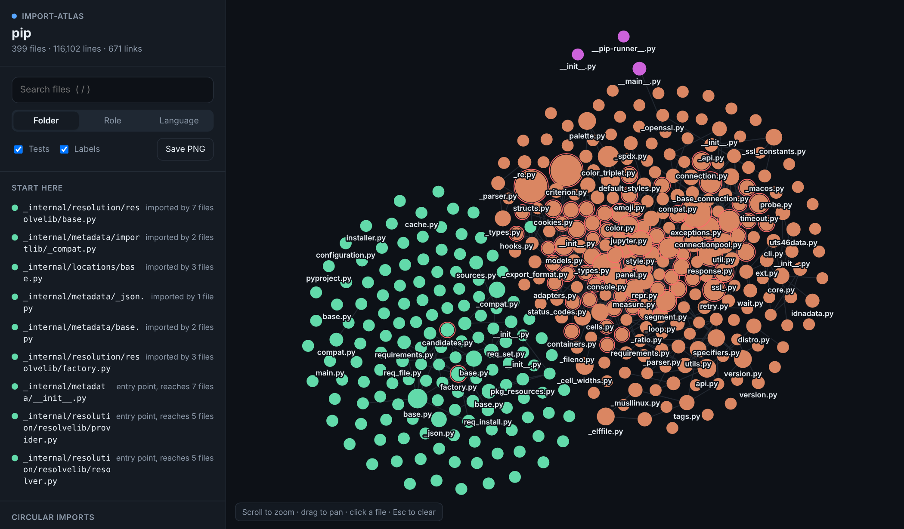
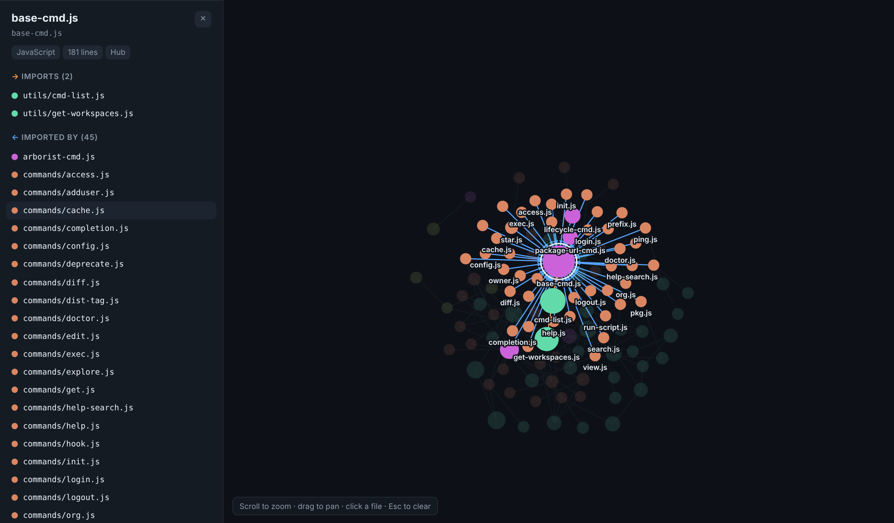

# import-atlas

**Open any codebase and see how it fits together. One command, one offline HTML file.**

```bash
pip install import-atlas
import-atlas . --open
```



*The map of [pip](https://github.com/pypa/pip) (399 files, 116k lines), generated in one second. Each dot is a file, size shows how much the rest of the code depends on it, colour is its folder.*



*Click a file and everything around it lights up: orange arrows go out to what it imports, blue arrows come in from what imports it.*

[Try a live example](https://htmlpreview.github.io/?https://github.com/claudeee617-hue/import-atlas/blob/main/docs/example-pip.html) (the pip map above, fully interactive).

## Why

Every new developer asks the same thing: *"This repo has 400 files. Where do I start?"*

`ls` doesn't answer it. Reading `README` doesn't answer it. `import-atlas` does, by reading the real `import` statements and drawing what they say:

- **Start here:** the files everything else depends on, and the entry points that reach the most code.
- **Circular imports:** groups of files that import each other, ready to click through.
- **What depends on this?** Select any file to see exactly what it imports and what imports it, before you change it.
- **Folders, roles and languages:** colour the map by folder, by role (entry point, hub, leaf...) or by language.

No server, no account, no dependencies. Your code never leaves your machine, and the output is a single `.html` file you can email, attach to a PR or open years later.

## Usage

```bash
import-atlas                       # map the current folder -> import-atlas.html
import-atlas ~/code/myapp --open   # map another folder and open it
import-atlas . --exclude migrations --exclude '*.gen.ts'
import-atlas . --json graph.json   # also write the raw graph
import-atlas . --fail-on-cycles    # exit 1 if circular imports exist (CI)
```

In the browser: scroll to zoom, drag to pan, click a file, `/` to search, `Esc` to clear, `0` to fit the view, and **Save PNG** to export the map.

It also prints a quick summary in the terminal:

```text
pip: 399 files, 116,102 lines, 671 links  (Python 398, JavaScript 1)

Start reading here:
  _internal/resolution/resolvelib/base.py  (imported by 7 files)
  _internal/metadata/importlib/_compat.py  (imported by 2 files)
  ...

7 circular import groups:
  _vendor/urllib3/__init__.py, _vendor/urllib3/_base_connection.py, ... +22 more
```

## What it understands

| Language | Imports it follows |
|---|---|
| Python | `import x`, `from x import y`, relative imports, `src/` layouts, namespace packages |
| JavaScript / TypeScript | `import`, `export ... from`, `require()`, dynamic `import()`, `index` files, `@/` aliases |
| Go | imports of packages in your own module (`go.mod`) |

Anything that doesn't resolve to a file inside the folder (`react`, `requests`, the standard library) is not a link. It is listed as an external package instead.

**Limits, honestly:** this reads static imports. It can't see dynamic `importlib` tricks, runtime plugin loading or path aliases beyond `@/`, `~/` and `#/`. For Go, an import links to the package's main file, not every file in it. Repos over 1,500 files show the most connected 1,500 (change it with `--max-nodes`).

## Use it in CI

Catch new circular imports before they merge:

```yaml
- uses: actions/setup-python@v5
  with: { python-version: "3.12" }
- run: pip install import-atlas
- run: import-atlas . --fail-on-cycles -o atlas.html
- uses: actions/upload-artifact@v4
  with: { name: import-atlas, path: atlas.html }
```

## Development

```bash
git clone https://github.com/claudeee617-hue/import-atlas
cd import-atlas
pip install -e .
python -m unittest discover -s tests
```

See [CONTRIBUTING.md](CONTRIBUTING.md). New language support is the most welcome kind of PR.

## License

MIT
